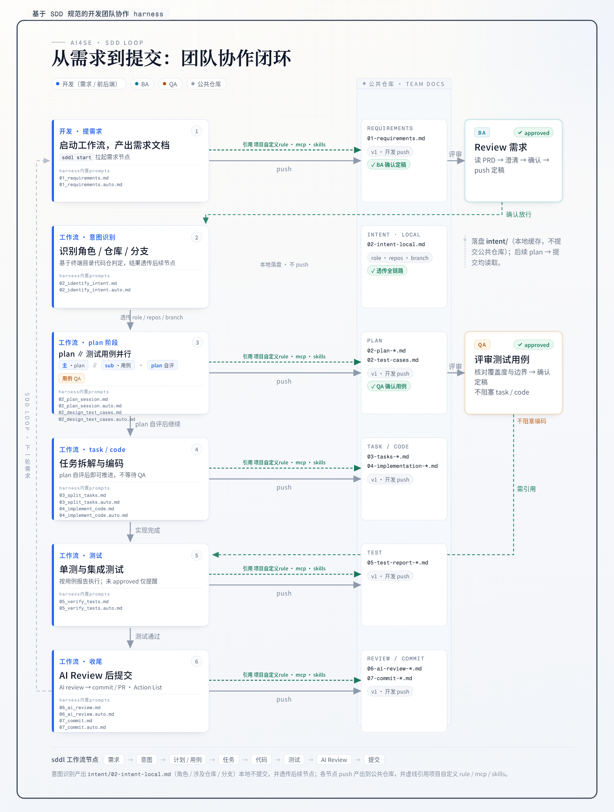

# ai4se-sddl-collab-harness

基于 SDD 的团队协作 harness：从**需求 → 计划/用例 → 任务 → 代码 → 测试 → AI Review → 提交**。配置与扩展写在业务项目里，文档落在团队共享的 `project_docs_dir`。



## 目录

1. [简单介绍](#1-简单介绍)
2. [快速使用](#2-快速使用)
3. [扩展能力](#3-扩展能力)
4. [内置 Skill](#4-内置-skill)
5. [公共文档](#5-公共文档)
6. [断点续跑](#6-断点续跑)

---

## 1. 简单介绍

- 按节点跑完整交付链路；人工模式可澄清/审批，`--auto` 无人值守自决。
- 产出按角色落盘（`-backend` / `-front` / `-all`）；需求与用例报告共用一份。
- **项目定制不改引擎 prompt**：改 `project_docs_dir` 下的扩展规则，以及业务侧 `workflow-local.yaml`。
- 结束时汇总须人工执行的事项（SQL / 配置等）到 Action List。

---

## 2. 快速使用

```bash
# 引擎仓库：初始化环境（Python 3.10～3.14）
./init_env.sh          # macOS / Linux
# Windows: .\init_env.cmd

# 业务项目根
sddl init              # 生成配置，填写 project_docs_dir
sddl start --file "/path/to/prd.md" --name login
sddl start --name login --auto          # 无人值守
sddl start --name login                 # 续跑（不要加 --fresh）
```

| 开关 | 作用 |
|------|------|
| `--file` | 需求文件 |
| `--name` | 需求目录名 → `spec/<name>/` |
| `--auto` | 无人值守 |
| `--fresh` | 清空该需求产出后重来（与续跑互斥） |
| `--tool` / `--model` | 可选；覆盖**全部**节点。不传则用业务 `workflow-local.yaml` |

需要拼启动命令时用内置 [start-workflow](#41-start-workflow) skill，命令在**终端**执行。

---

## 3. 扩展能力

### 核心配置（业务项目根）

```text
your-project/
└── sdd-loop-workflow-config/
    ├── workflow-local.yaml              # project_docs_dir、tool/model、extend_rules、阈值
    └── suggestion-confidence-rules.yaml # 项目把握规则（叠加引擎基线；init 不覆盖）
```

`workflow-local.yaml` 可配：

| 项 | 说明 |
|----|------|
| `project_docs_dir` | 团队文档仓下的**项目目录**（必填且须存在） |
| `defaults.tool` / `defaults.model` | 全节点默认 |
| `nodes.<id>.tool` / `model` | **按节点**覆盖 tool / model |
| `nodes.<id>.extend_rules` | 该节点要读的规则 md（路径相对 `project_docs_dir`） |
| `nodes.<id>.recommendation_threshold` | 推荐自动采纳阈值（默认 0.8） |

优先级：**节点 tool/model > defaults > 引擎 `config/workflow.yaml`**。`model: ""` 表示用该 tool 默认模型。`tool` 可选：`claude_code` / `cursor` / `codex` / `oh_my_pi`（`omp`）/ `echo`。

```yaml
project_docs_dir: ../team-docs/my-project

defaults:
  tool: claude_code
  model: ""

nodes:
  analyze_requirements:
    tool: claude_code
    model: ""
    recommendation_threshold: 0.8
    extend_rules:
      - common_extend_rules/product.md
  plan_session:
    tool: cursor          # 仅计划节点换工具
    model: ""
    recommendation_threshold: 0.8
    extend_rules:
      - common_extend_rules/coding.md
      - repos/xqgy-service/extend_rules/api.md
  implement_code:
    tool: claude_code
    model: "claude-opus-4"
    recommendation_threshold: 0.8
    extend_rules: []
```

启动时一般**不带** `--tool`，按上表按节点生效；带 `--tool` / `--model` 会覆盖全部节点（调试用）。

### 自定义项目 rule

规则写在 `project_docs_dir`，**改源文件，不要只改 `temp-prompts/references/` 副本**：

```text
<project_docs_dir>/
  common_extend_rules/<文件>.md           # 公共
  repos/<仓库名>/extend_rules/<文件>.md   # 单仓库（还需在 involved_repos 里）
```

规则优先级高于引擎通用提示词。

### 项目侧 MCP / Rules / Skills

不在 yaml 里配工具表。在对应 **extend_rules md** 里写清要用的 MCP、仓库 Rules、业务 Skills。MCP 需事先在 AI 环境配好。

### `suggestion_confidence`

交互澄清里每条建议带 `suggestion_confidence`（0～1）：`>= recommendation_threshold` 自动采纳，否则问用户。

- 引擎基线：`config/suggestion-confidence-rules.yaml`
- 项目叠加：业务 `sdd-loop-workflow-config/suggestion-confidence-rules.yaml`（`high_confidence_rules` / `low_confidence_rules`，按节点追加；init 不覆盖）

```yaml
nodes:
  analyze_requirements:
    high_confidence_rules:
      - condition: "需求来自已确认的 PRD"
        reason: "有 PRD 背书"
    low_confidence_rules:
      - condition: "涉及支付链路"
        reason: "高风险不宜高置信自决"
```

---

## 4. 内置 Skill

`sddl init` 会把引擎内置 skill 同步到业务项目的 AI 技能目录（如 `.cursor/skills/`）。当前内置如下。

### 4.1 `start-workflow`

**作用**：根据对话里的需求来源，落本地需求文件（如需要），并拼好完整的 `sddl start ...` 命令交给你。

| 场景 | 行为 |
|------|------|
| 已有本地 PRD 路径 | 校验后直接拼 `--file` |
| 外部系统（Jira / Colla 等） | 用已配置的 MCP 拉取 → 写入 `origin_requirements/` → 再拼命令 |
| 续跑 / 审批后继续 | **不要**再用本 skill 拼启动命令；由外部终端里已在跑的进程续跑 |

**硬约束**：只准备命令，**禁止**在当前 AI session 里执行 `sddl start`。你复制命令到业务项目根的终端再跑。

---

## 5. 公共文档

### 目录约定

```text
<project_docs_dir>/
  origin_requirements/          # 原始需求
  common_extend_rules/          # 公共扩展规则
  repos/<仓库名>/extend_rules/  # 仓库扩展规则
  spec/<需求名>/
    requirements/               # 01-requirements.md
    intent/                     # 本地意图缓存（不提交）
    plan/                       # 计划、用例报告 + attachments/
    task/                       # 任务
    code/                       # 实现 / 测试 / review / 提交
    temp-prompts/               # 运行时提示词（相对此目录解析文档路径）
```

### 使用与规范（简）

- **读提示词里的文档路径**：相对 `temp-prompts/`，不要相对终端 cwd。
- **产出正文互引**：相对该正文文件所在目录；禁止本机绝对路径。
- **改规则**：写回 `common_extend_rules/` 或 `repos/.../extend_rules/`。
- **禁止**把 `spec/` 文档产出 commit 进业务仓库。
- 编码→提交各节点以产出里的 `*_approval.status: approved` 作为定稿放行标记。

---

## 6. 断点续跑

产出在 `<project_docs_dir>/spec/<name>/`。同 `--name` 再 `sddl start`（**不加** `--fresh`）即从断点继续。

| 情况 | 做法 |
|------|------|
| 终端进程还在 | 对话里完成澄清/审批即可，勿再 start |
| 进程已退出 | `sddl start --name <同名>` |
| 要推倒重来 | 加 `--fresh`（会清空该需求阶段产出，含 `intent/`） |

续跑依据：已有定稿/approval 与文末 Workflow 状态；有本地 `intent/02-intent-local.md` 则跳过意图识别。编码段未写对应 `*_approval.approved` 时不会跳步。
